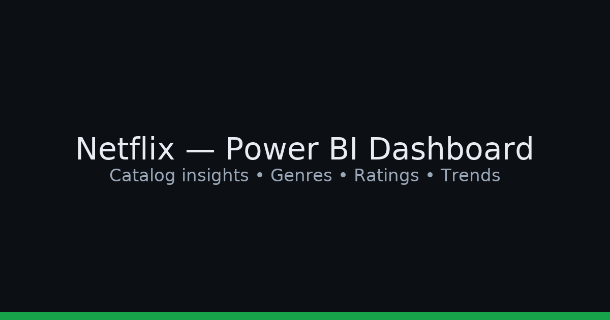

# Netflix Movies & TV Shows: Power BI Dashboard




An interactive **Power BI dashboard** built from the Netflix catalog dataset, with optional IMDb enrichment.  
It explores how the catalog has grown over time, what the content mix looks like by type, genre and country, how titles are distributed across maturity ratings, and the key KPIs.

---

## 🎯 Questions the dashboard answers

- How has the number of titles added to Netflix changed over time?
- What is the split between **Movies** and **TV Shows**?
- Which **genres** and **countries** contribute the most content?
- How are titles distributed across **maturity ratings**?
- How do ratings compare when IMDb data is included?

---

## ✨ Features

- Interactive **slicers and drilldowns** (type, genre, country, rating, year)
- **KPI cards** for headline numbers
- Trend charts for content growth over time
- Breakdowns by type, genre, country and maturity rating
- Optional **IMDb-enriched** view using `netflix_titles_with_IMDB.csv`

<!--
## 🖼️ Dashboard Preview (uncomment after adding your screenshots)


-->

---

## 📦 Files Included

| File | Description |
|---|---|
| `reports/Netflix_Dashboard.pbix` | The Power BI report (open in Power BI Desktop) |
| `data/raw/netflix_titles.csv` | Base Netflix catalog |
| `data/raw/netflix_titles_with_IMDB.csv` | Optional version enriched with IMDb fields |
| `assets/banner.png` | Repository banner |

> If the `.pbix` file ever exceeds GitHub's 100 MB limit, store it with **Git LFS** or attach it to a **GitHub Release** and link it here.

---

## ▶️ How to Use

1. Install **Power BI Desktop** (free, Windows).
2. Clone or download this repository.
3. Open `reports/Netflix_Dashboard.pbix`.
4. If Power BI asks for the data source, point it to the files in this repo:
   - `data/raw/netflix_titles.csv`
   - `data/raw/netflix_titles_with_IMDB.csv` (if used in your model)
5. Click **Refresh** and explore the report with the slicers.

---

## 🚀 Publish (optional)

Publish the report to **Power BI Service** via **Home ▸ Publish**, then add the share link or embed URL to your portfolio.

---

## 🧱 Repository Structure

```
.
├─ assets/
│  └─ banner.png
├─ data/
│  ├─ raw/             # source CSV files
│  └─ processed/       # git-ignored
├─ reports/
│  ├─ Netflix_Dashboard.pbix
│  └─ figures/         # exported dashboard images
├─ .github/workflows/ci.yml
├─ .gitignore
├─ LICENSE
└─ README.md
```

---

## ✅ Continuous Integration

A lightweight GitHub Actions workflow runs on every push to check that the repository is in a healthy state.

---

## 👤 Author

**Lohith B N** · [Portfolio](https://portfolio-0lzq.onrender.com/) · [LinkedIn](https://www.linkedin.com/in/lohith-b-n/) · [GitHub](https://github.com/Lohithbn12)

## © License

MIT © Lohith B N
